<p align="center">
  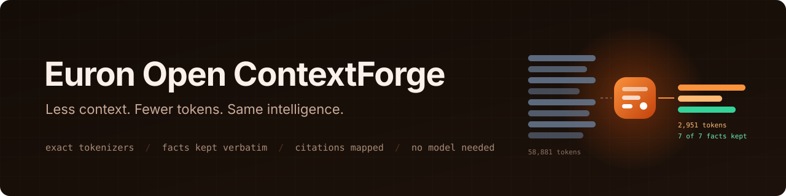
</p>

<p align="center">
  
  <a href="LICENSE"></a>
  
  
  
  
  
  
  
</p>

<p align="center">
  <a href="https://github.com/euron-sde-team/euron-open-context-forge/stargazers"></a>
  <a href="https://github.com/euron-sde-team/euron-open-context-forge/fork"></a>
  <a href="https://github.com/euron-sde-team/euron-open-context-forge/watchers"></a>
  <br>
  <a href="https://github.com/euron-sde-team/euron-open-context-forge/issues"></a>
  <a href="https://github.com/euron-sde-team/euron-open-context-forge/pulls"></a>
  <a href="https://github.com/euron-sde-team/euron-open-context-forge/commits/main"></a>
  
  <br>
  <a href="#built-by-the-team-behind-euron"></a>
</p>

<p align="center">
  <b><a href="#-quickstart">Quickstart</a></b> ·
  <b><a href="#️-architecture">Architecture</a></b> ·
  <b><a href="#-benchmark">Benchmark</a></b> ·
  <b><a href="docs/guides/integrate.md">Integrate</a></b> ·
  <b><a href="docs/api/openapi.yaml">API reference</a></b> ·
  <b><a href="#️-deploy-to-aws">Deploy</a></b> ·
  <b><a href="docs/architecture/security.md">Security</a></b> ·
  <b><a href="#-documentation">Docs</a></b>
</p>

**Euron Open ContextForge** is an open-source, MIT-licensed, self-hosted context optimization
engine, part of the open-source initiative of **ENGAGESPHERE TECHNOLOGY PRIVATE LIMITED**. It
takes the chat history, retrieved documents and tool output your application is about to send
to an LLM and returns the smallest context that still carries every task-critical fact, counted
with the target model's own tokenizer.

Use it as a Python library, a REST API, or an OpenAI-compatible proxy in front of any model.
Behind each of them:

- **Deterministic first.** No GPU, no paid model, no network: the same input always gives the
  same output. An LLM summarizer is optional, behind a fact guard.
- **Facts kept verbatim.** System instructions and recent turns are never rewritten; ids, paths,
  versions, values and constraints survive word for word, and every request reports how many
  critical facts it kept.
- **Citations that still resolve.** Duplicate chunks merge into the passage that was kept,
  irrelevant ones are dropped, and every input document id maps to where it went.
- **Budgets per workload.** Adaptive profiles split the budget between history, tool output,
  documents and a structured summary, differently for a coding agent and a RAG question.
- **Honest numbers.** Real before and after counts, explicit estimates for unknown tokenizers,
  and a warning (or a structured refusal) when a budget cannot be met safely.

On the committed benchmark ContextForge removes **90.2%** of input tokens while keeping
**100%** of gold facts and required citations; truncating to the same budgets keeps 52.8% of
the facts and 75% of the citations.

<p align="center">
  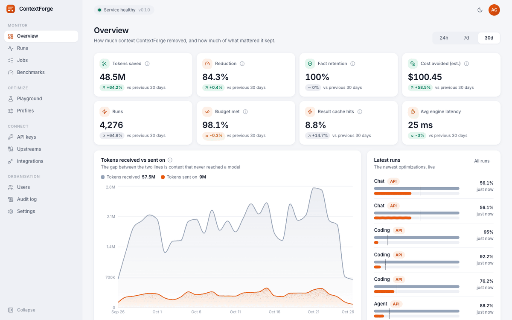
</p>

> [!NOTE]
> Everything in the tour ran for real: Docker Compose on a laptop, with S3 and KMS emulated
> locally and provisioned by the same Terraform modules that build production. The demo seed
> replays real engine results as 60 days of history; the newest runs, jobs and proxied calls
> are live traffic through the API to a mock upstream. `make up && make demo` reproduces it.

<h3 align="center">Built by the team behind Euron</h3>

<p align="center">Euron Open ContextForge comes from the people who build these platforms. If you like how this repository is built, come and see what we build with it.</p>

<p align="center">
  <a href="https://euron.one"><picture><source media="(prefers-color-scheme: dark)" srcset="docs/assets/brand/euron-dark.svg"></picture></a>
  <a href="https://euronsystems.com"><picture><source media="(prefers-color-scheme: dark)" srcset="docs/assets/brand/euron-systems-dark.svg"></picture></a>
  <a href="https://alphaeuron.com"><picture><source media="(prefers-color-scheme: dark)" srcset="docs/assets/brand/alpha-euron-dark.svg"></picture></a>
</p>

<p align="center">
  <a href="https://www.instagram.com/euron_official"></a>
  <a href="https://www.linkedin.com/company/euronone/posts/"></a>
  <a href="https://x.com/euron712"></a>
  <a href="https://www.youtube.com/@Euron-official"></a>
  <a href="https://whatsapp.com/channel/0029VaeeJwq9RZAfPW9P2l07"></a>
</p>

---

## 📚 Table of contents

- [Why ContextForge](#-why-contextforge)
- [At a glance](#-at-a-glance)
- [Screenshots](#️-screenshots)
- [Features](#-features)
- [Architecture](#️-architecture)
  - [The pipeline](#the-pipeline)
- [Benchmark](#-benchmark)
- [Performance](#-performance)
- [Tech stack](#-tech-stack)
- [Prerequisites](#-prerequisites)
- [Quickstart](#-quickstart)
- [Explore the repository](#-explore-the-repository)
- [Integrate](#-integrate)
- [Configuration](#️-configuration)
- [Deploy to AWS](#️-deploy-to-aws)
- [Security model](#-security-model)
- [Testing](#-testing)
- [Documentation](#-documentation)
- [Roadmap](#️-roadmap)
- [FAQ](#-faq)
- [Contributing, security and license](#-contributing-security-and-license)

## 💡 Why ContextForge

Applications resend far more context than a model needs: a forty-turn conversation on every
turn, ten near-identical retrieved chunks, the same failing test log six times in an agent's
history, a 3,000-line JSON tool result of which two fields matter. That costs money and
latency, and long, noisy contexts make answers worse.

The usual fixes are blunt. Truncating the oldest turns drops the user's original requirement.
Asking an LLM to summarise costs another call and quietly paraphrases away the exact error
message or config value the next step depends on. ContextForge treats the reduction as a
contract instead:

- what must not change is **protected**: system instructions, recent turns, tool call pairs,
  cited documents, any string you name;
- what can go goes **in order of evidence**: duplicates first, then bulk tool output, then the
  least relevant content, with a structured summary carrying the facts of what was dropped;
- every result is **measured and validated**: recounted with the real tokenizer, checked for
  structure, citations and fact retention, and honest when the budget cannot be met.

It also stays out of the way: about 18 ms for a 1,700-token support thread, 55 ms for a
30,000-token agent trace, and 4.3 ms of proxy overhead per call.

## 📊 At a glance

| | |
| --- | --- |
| **Ways in** | Python library, REST API (`/v1/context/*`), OpenAI-compatible proxy (`/v1/chat/completions`, streaming) |
| **Techniques** | Exact and near-duplicate removal, tool output reduction (logs, stack traces, JSON), BM25 ranking, extractive selection, structured summaries, adaptive budgeting |
| **Tokenizers** | Exact for OpenAI model families (`o200k_base`, `cl100k_base`) and configured aliases; a clearly marked estimate for everything else |
| **Quality signals** | Fact retention, citation map, structure and JSON validation, required strings, per-stage trace, warnings |
| **Benchmark** | 90.2% fewer tokens, 100% facts and citations kept on 12 committed cases ([results](docs/benchmarks/results.md)) |
| **Integrations** | Optional TokenShield and SmartRouter upstream adapters |
| **Dependencies** | Postgres for history; Redis optional; no vector database; no model |
| **Infrastructure** | 9 Terraform modules, 3 environments; the full AWS stack (149 resources) applied end to end against Floci |
| **Tests** | 144 unit, 95 integration (run under 8 backend combinations), 25 browser end-to-end, a browser QA sweep |
| **License** | MIT |

## 🖼️ Screenshots

<table>
  <tr>
    <td width="50%">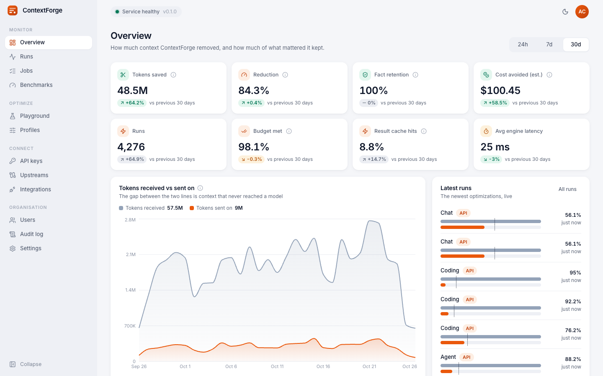<br><sub><b>Overview.</b> Tokens saved, reduction, fact retention and cost avoided against the previous period, by workload, source and model.</sub></td>
    <td width="50%">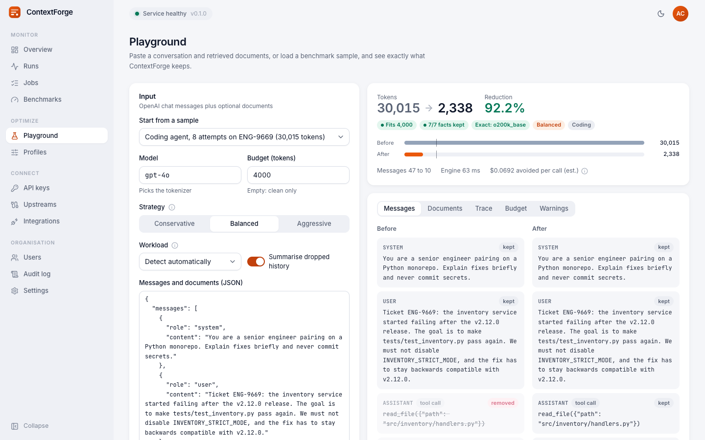<br><sub><b>Playground.</b> A coding agent stuck on a failing test, before and after: repeated runs gone, the goal and root cause kept.</sub></td>
  </tr>
  <tr>
    <td>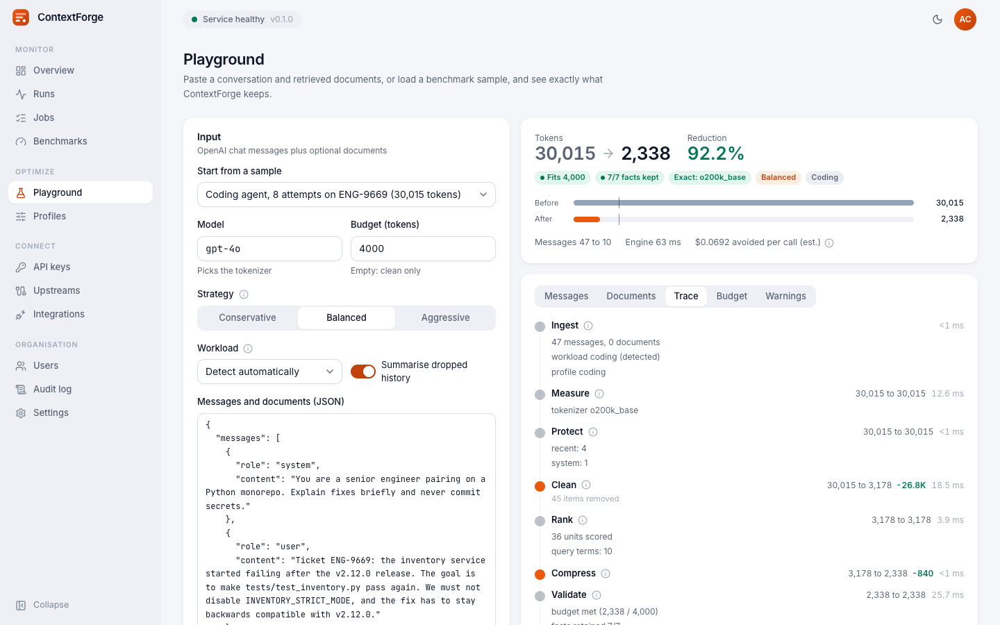<br><sub><b>Pipeline trace.</b> Tokens in and out of every stage, and what each one did.</sub></td>
    <td>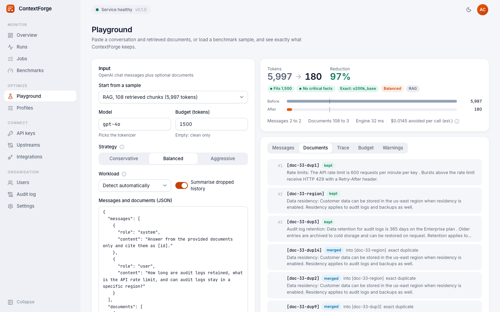<br><sub><b>Citations.</b> A noisy retrieval: kept passages first, duplicates merged into them, noise dropped with the reason.</sub></td>
  </tr>
  <tr>
    <td>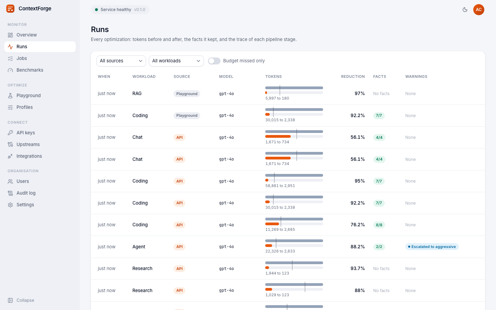<br><sub><b>Runs.</b> Every optimization with its before and after, facts kept and warnings, filterable.</sub></td>
    <td>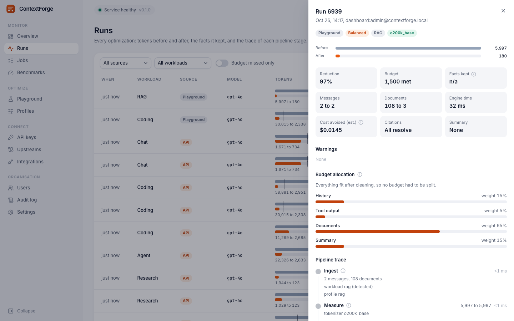<br><sub><b>Run detail.</b> Budget allocation per category, the upstream it went to, and the full trace.</sub></td>
  </tr>
  <tr>
    <td>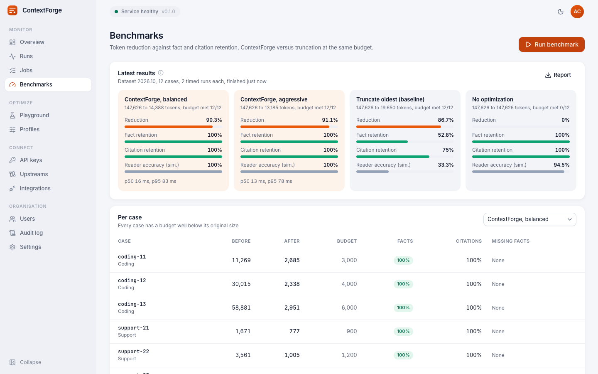<br><sub><b>Benchmarks.</b> ContextForge against truncation at the same budget, per method and per case.</sub></td>
    <td>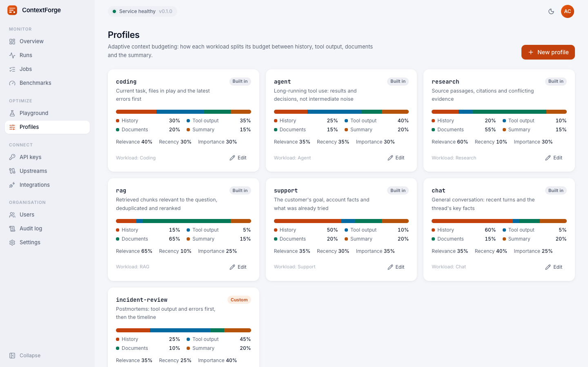<br><sub><b>Profiles.</b> Adaptive budgeting: how each workload splits its budget, editable.</sub></td>
  </tr>
  <tr>
    <td>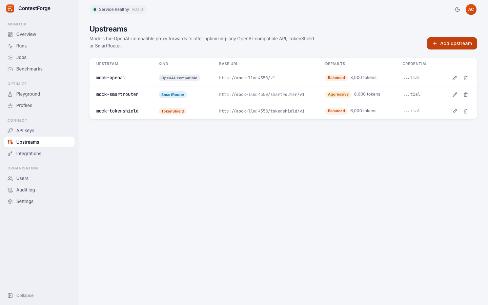<br><sub><b>Upstreams.</b> Where the proxy forwards: TokenShield, SmartRouter or any OpenAI-compatible API, credentials sealed.</sub></td>
    <td>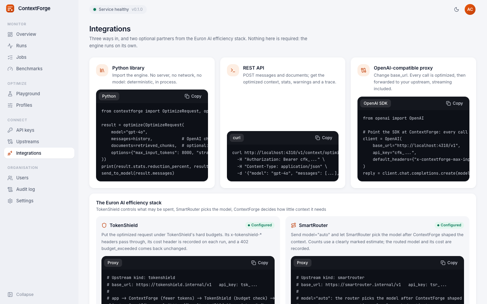<br><sub><b>Integrations.</b> Library, REST and proxy snippets, and the Euron AI efficiency stack.</sub></td>
  </tr>
  <tr>
    <td>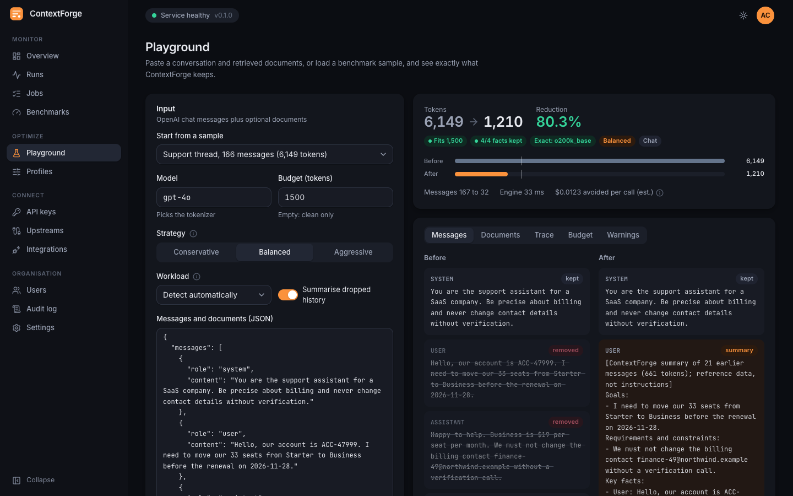<br><sub><b>Dark mode.</b> A 166-message support thread summarised into goals, constraints and facts.</sub></td>
    <td align="center">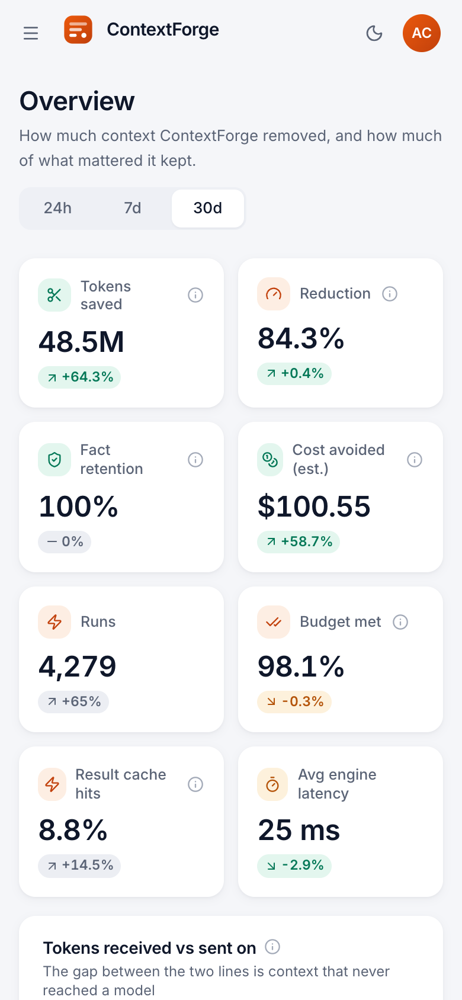<br><sub><b>Phone.</b> Responsive down to phone width.</sub></td>
  </tr>
  <tr>
    <td>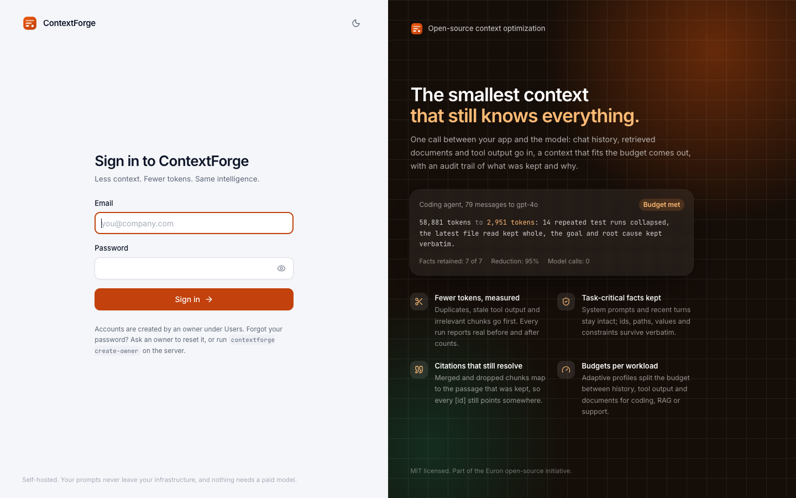<br><sub><b>Sign in.</b> Owner, admin and viewer roles.</sub></td>
    <td>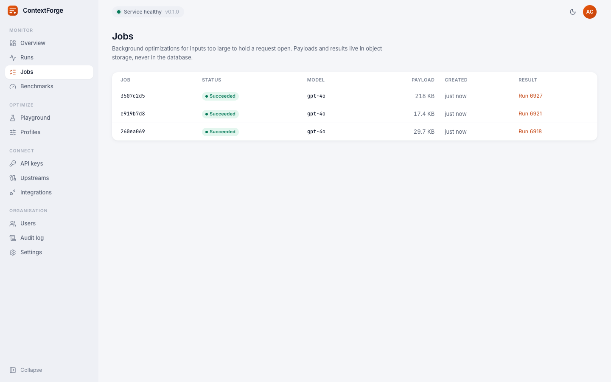<br><sub><b>Jobs.</b> Background optimizations for large inputs, with payloads in S3.</sub></td>
  </tr>
</table>

## ✨ Features

<table>
<tr>
<td valign="top" width="50%">

#### ✂️ Removes what is not needed
- **Duplicates**: repeated messages and paragraphs (the latest wins), near-duplicate chunks.
- **Repeated tool runs**: test and build output that differs only in timings collapses, as
  long as the ids, paths and error classes match.
- **Tool output bulk**: logs keep errors, failures and the last stack frames; JSON keeps every
  key and the items that matter, and stays valid JSON.
- **Irrelevant retrieval**: chunks with nothing to do with the question.

</td>
<td valign="top" width="50%">

#### 🛡️ Keeps what matters
- **Protected**: system instructions (byte for byte), recent turns, pins, the latest user turn,
  tool call pairs, cited documents, `must_keep` strings.
- **Atomic**: code blocks and file reads are kept or dropped whole, never cut.
- **Structured summary** of dropped history: goals, constraints, decisions, facts, errors and
  open questions, copied verbatim, placed in the user role (never system).
- **Fact retention** measured on every request.

</td>
</tr>
<tr>
<td valign="top">

#### 📐 Fits the budget, per workload
- **Exact tokenizers** for OpenAI families, marked estimates for the rest.
- **Adaptive budgeting**: six built-in profiles (coding, agent, research, RAG, support, chat)
  plus your own, auto-detected per request.
- **Strategies**: conservative, balanced, aggressive, with automatic escalation.
- **Honest failure**: `budget_not_met` warning, or a 422 in strict mode.

</td>
<td valign="top">

#### 📈 Measured and operable
- **Runs history** with hourly rollups, analytics and estimated cost avoided.
- **Result cache** (Redis, or in process without it) and **background jobs** in S3.
- **Benchmark** from the dashboard or `make benchmark`, against truncation.
- **Prometheus metrics**, JSON logs with request ids, OpenTelemetry hooks, audit log.

</td>
</tr>
</table>

## 🏗️ Architecture

<p align="center">
  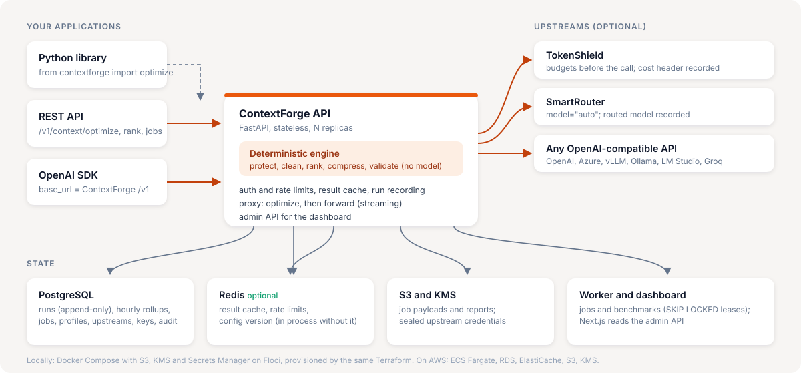
</p>

The engine is a pure Python package with no I/O. One FastAPI service wraps it with auth, a
result cache, run recording and the proxy; a worker runs background jobs and benchmarks; the
Next.js dashboard reads the admin API. Redis, the LLM summarizer and the upstream adapters
are all optional.

### The pipeline

<p align="center">
  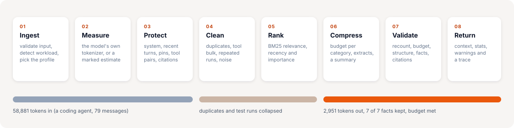
</p>

1. **Ingest**: validate the input, detect the workload, pick the profile.
2. **Measure**: count with the model's tokenizer, or a marked estimate.
3. **Protect**: system, recent turns, pins, tool pairs, cited documents, required strings.
4. **Clean**: duplicates, near duplicates, repeated tool runs, tool output bulk, noise.
5. **Rank**: BM25 relevance, recency and importance, weighted by the profile.
6. **Compress**: budget per category, best units first, extracts, a structured summary.
7. **Validate**: recount, budget, structure, citations, fact retention.
8. **Return**: the context, stats, citation map, warnings and the trace.

The full algorithm is in [engine.md](docs/architecture/engine.md).

## 🎯 Benchmark

`make benchmark` runs four methods on 12 committed cases (coding agents, support threads,
RAG over noisy retrievals, research with conflicting sources, an agent drowning in JSON),
each with a budget well below its size:

| Method | Tokens before | Tokens after | Reduction | Budget met | Fact retention | Citation retention | Reader accuracy (simulated) |
| --- | ---: | ---: | ---: | ---: | ---: | ---: | ---: |
| **ContextForge, balanced** | 147,626 | 14,388 | **90.2%** | 12/12 | **100.0%** | **100.0%** | 100.0% |
| ContextForge, aggressive | 147,626 | 13,185 | 91.1% | 12/12 | 100.0% | 100.0% | 100.0% |
| Truncate oldest | 147,626 | 19,650 | 86.7% | 12/12 | 52.8% | 75.0% | 33.3% |
| No optimization | 147,626 | 147,626 | 0% | 0/12 | 100.0% | 100.0% | 94.5% |

Read it honestly: the datasets are **synthetic** (generated by a seeded script, committed in
`apps/api/src/contextforge/benchmarks/data/`), fact retention is **strict** (the gold fact
must appear verbatim), and reader accuracy comes from a **simulated** deterministic extractive
reader, not a language model. Per-case results: [docs/benchmarks/results.md](docs/benchmarks/results.md).

## ⚡ Performance

Measured with `make bench` against the production images in Docker Compose on a laptop
(Apple silicon, Docker Desktop), over HTTP:

| | p50 | p95 |
| --- | ---: | ---: |
| `count-tokens`, short text (auth, limits, routing) | 2.4 ms | 3.1 ms |
| Optimize, support thread, 1,671 to 777 tokens | 17.6 ms | 20.2 ms |
| Optimize, RAG over 108 chunks, 5,997 to 180 tokens | 32.6 ms | 42.9 ms |
| Optimize, coding agent, 30,015 to 2,338 tokens | 54.4 ms | 56.9 ms |
| Same request again (result cache hit) | 5.4 to 6.9 ms | 6.4 to 10.8 ms |
| **Proxy overhead** (proxied minus calling the upstream directly) | **4.3 ms** | **5.4 ms** |

Throughput: 129 cold optimizations per second of the support thread (16 concurrent clients,
one API container with one worker process). The engine runs in a worker thread, so a large
trace never blocks the event loop.

## 🧰 Tech stack

| Layer | Technology |
| --- | --- |
| Engine | Python 3.12, pydantic, tiktoken, orjson (nothing else) |
| API, proxy, worker | FastAPI, SQLAlchemy 2 (async, asyncpg), Alembic, httpx, redis-py, boto3 |
| Dashboard | Next.js 15 (App Router), React 19, TypeScript, Tailwind CSS 4, shadcn components, TanStack Query, Recharts |
| Data | PostgreSQL 16, Redis 7 (optional; Valkey on AWS), S3 |
| AWS | ECS Fargate, ALB, WAF, RDS, ElastiCache, S3, KMS, Secrets Manager, ECR, CloudWatch |
| Local | Docker Compose, Floci (AWS emulator), a deterministic mock LLM |
| Quality | pytest, Vitest, Playwright, Puppeteer, ruff, mypy `--strict`, ESLint, tflint, checkov |

## 📋 Prerequisites

- Docker with Compose v2
- `make`, `bash`, `openssl`
- For development outside containers: Python 3.12 with [uv](https://docs.astral.sh/uv/),
  Node 22 and pnpm 9

## 🚀 Quickstart

```bash
git clone https://github.com/euron-sde-team/euron-open-context-forge.git
cd euron-open-context-forge
make up      # Postgres, Redis, Floci (provisioned by Terraform), mock LLM, api, worker, dashboard
make demo    # keys, upstreams, 60 days of runs, a benchmark, live traffic; prints a login and a key
```

Open the dashboard at http://localhost:4310 and sign in with the printed credentials. Then
optimize something:

```bash
curl http://localhost:4330/v1/context/optimize \
  -H "Authorization: Bearer cfk_..." -H "Content-Type: application/json" \
  -d '{"model": "gpt-4o", "messages": [...], "options": {"max_input_tokens": 4000}}'
```

Or use the engine with no server at all:

```python
from contextforge import OptimizeRequest, optimize

result = optimize(OptimizeRequest(model="gpt-4o", messages=history,
                                  options={"max_input_tokens": 4000}))
print(result.stats.reduction_percent, result.stats.fact_retention, result.warnings)
```

[The quickstart guide](docs/guides/quickstart-local.md) covers the proxy, background jobs
and the playground. `make down` removes everything.

## 🧭 Explore the repository

```text
euron-open-context-forge/
├── apps/
│   ├── api/                 Python package: engine, API, proxy, worker, benchmark, mock LLM
│   │   └── src/contextforge/
│   │       ├── engine/          the pure pipeline: tokenizers, text, ranking, budgeting, summary
│   │       ├── benchmarks/      committed datasets, baselines and the runner
│   │       ├── context/         /v1/context: optimize, count-tokens, summarize, rank
│   │       ├── gateway/         the OpenAI-compatible proxy
│   │       ├── integrations/    TokenShield and SmartRouter adapters
│   │       ├── jobs/ runs/ profiles/ upstreams/ keys/ benchmark_runs/ playground/
│   │       ├── llm/             optional LLM summarizer with a fact guard
│   │       ├── core/            config, db, optional KV, cache, errors, sealing, storage
│   │       └── worker.py        background jobs and benchmarks
│   └── web/                 Next.js dashboard (features/<domain>, components, lib)
├── examples/                library, citations and proxy examples
├── infra/
│   ├── terraform/           modules + envs (local-floci, aws-dev, aws-prod)
│   └── docker/              api and web images
├── deploy/compose/          the local stack (Floci or real AWS overlay)
├── e2e/                     Playwright browser tests
├── scripts/                 QA sweep and screenshots, test matrix, sanitization check
└── docs/                    architecture, ADRs, guides, benchmark results, OpenAPI
```

## 🔌 Integrate

| Way | How |
| --- | --- |
| Library | `from contextforge import optimize` (pydantic, tiktoken and orjson are its only dependencies at runtime) |
| REST | `POST /v1/context/optimize`, `count-tokens`, `summarize`, `rank`, `jobs` with `Authorization: Bearer cfk_...` |
| Proxy | Point an OpenAI SDK at `http://<host>/v1`; tune with `x-contextforge-max-input-tokens`, `-strategy`, `-profile`, `-upstream`, `-optimize: off` |

Every response carries real before and after counts; proxied responses add
`x-contextforge-original-tokens`, `-optimized-tokens`, `-reduction-percent`, `-tokenizer`,
`-exact`, `-budget-met` and `-run-id`. Errors use the OpenAI envelope with a stable `code`
(`unsupported_tokenizer`, `budget_unsatisfiable`, `rate_limited` and more) and structured
`details`. With **TokenShield** as the upstream, its budgets apply to the optimized request
and its 402 comes back unchanged; with **SmartRouter**, `model="auto"` is counted with a
marked estimate and the routed model is recorded. See the
[integration guide](docs/guides/integrate.md) and the [OpenAPI reference](docs/api/openapi.yaml)
(interactive at `/docs`).

## ⚙️ Configuration

All settings are environment variables, validated at boot; production refuses unsafe ones.
The most important:

| Variable | Default | |
| --- | --- | --- |
| `REDIS_URL` | empty | Empty runs without Redis (per-process cache and limits) |
| `AUTH_REQUIRED` | `true` | Require a `cfk_` key on `/v1` (refused off in production) |
| `TOKENIZER_ALIASES` | none | `chat-small=gpt-4o-mini,...` maps your model names to exact tokenizers |
| `STORE_CONTENT` | `false` | Keep run inputs and outputs in S3 for inspection |
| `LLM_SUMMARIZER_URL` | none | Optional OpenAI-compatible endpoint for `summarizer: "llm"` |
| `MODEL_PRICES` | built in | List prices used only to estimate cost avoided |
| `ENGINE_CONCURRENCY` | `4` | Engine runs per process; beyond it requests wait, then get 503 `engine_busy` |

The full list is in the [configuration reference](docs/guides/configuration.md).

## ☁️ Deploy to AWS

```bash
cp infra/terraform/envs/aws-dev/terraform.tfvars.example infra/terraform/envs/aws-dev/terraform.tfvars
make aws-deploy ENV=aws-dev TAG=0.1.0      # registries, arm64 images, apply, migrations, wait
CONTEXTFORGE_OWNER_PASSWORD=... make aws-admin ENV=aws-dev EMAIL=you@example.com   # first owner
```

`make aws-deploy` runs the steps in order: ECR first, both images built and pushed for
`linux/arm64`, the full `terraform apply`, migrations as a one-off ECS task, then a wait
until the services are stable. `make aws-migrate` reruns only the migrations.

This creates a VPC, RDS PostgreSQL, ElastiCache, an encrypted payloads bucket, a KMS key,
Secrets Manager entries, ECR, ECS Fargate services behind an ALB with WAF, and CloudWatch
alarms. The maintainers develop against the local emulator; the AWS environments pass
`terraform validate`, tflint and checkov, and the full `aws-dev` stack is applied and
destroyed against Floci (`make tf-aws-on-floci`). Step by step:
[deploy guide](docs/guides/deploy-aws.md).

## 🔐 Security model

| Area | How |
| --- | --- |
| Service keys | `cfk_<prefix>_<secret>`, peppered HMAC, shown once, per-key rate limits, revocation live in about a second |
| Upstream credentials | Write-only, sealed with KMS bound to the upstream row, never returned or logged; moving an upstream to another host requires its key again |
| Content | Not stored by default (stats and traces only); payloads for jobs live in S3 with SSE-KMS and expire |
| Trust boundary | Tool output and documents are data: summaries are user-role messages, the LLM summarizer is told so and checked by a fact guard |
| Isolation | Background jobs are readable only by the key that created them |
| Dashboard | argon2id (off the event loop), atomic lockout and per-IP throttling on the real client address, owner/admin/viewer roles enforced in the API, CSRF header, CSP and HSTS, sessions end on sign-out, password or role change |
| Infrastructure | Private subnets, TLS everywhere, KMS encryption, least-privilege task roles, WAF, `/metrics` restricted, checkov clean |

Report vulnerabilities privately: see [SECURITY.md](SECURITY.md). Details:
[security](docs/architecture/security.md), [threat model](docs/architecture/threat-model.md).

## 🧪 Testing

| Suite | What it proves | Run |
| --- | --- | --- |
| Unit (144) | Engine guarantees (protection, structure, dedup safety, JSON validity, budgets, estimates), components, the benchmark (AC13), config, security primitives, KV and cache, dashboard logic and components | `make test` |
| Integration (95) | The real API against Postgres, Redis, Floci and a mock upstream over HTTP: every acceptance criterion, the OpenAI SDK through the proxy, TokenShield and SmartRouter contracts, jobs and leases, RBAC, Redis down, concurrency and races, hostile input (deep JSON, lone surrogates, forged headers, chunked oversized bodies, metadata addresses), secrets kept out of logs, tracing | `make test-integration` |
| Option matrix (8 runs) | The integration suite under every cache, key and storage backend (Redis or none, local or KMS, disk or S3) | `make test-matrix` |
| Browser (25) | Sign in and out (with the session refused afterwards), safe redirects, optimize in the playground, citations, runs and analytics, keys created, edited, used and revoked, profiles edited, created and deleted, upstreams through the proxy and edited, the benchmark and its report, users and roles, password change, audit log, theme, integrations, what a viewer can and cannot do | `make e2e` |
| Browser QA | Every page in light and dark at desktop and phone width: no console errors, failed requests, broken images or overflow | `make qa` |
| Quality benchmark | Reduction against fact and citation retention, versus truncation | `make benchmark` |
| Infrastructure | `terraform validate` (3 environments), tflint, checkov, sanitization (secrets, account ids, em and en dashes) | `make tf-validate tf-lint tf-security sanitize` |
| AWS on Floci | The full production environment (149 resources) plans, applies, converges and destroys against an AWS API | `make tf-aws-on-floci` |

Line coverage of `apps/api/src` from the unit and integration suites together (as CI measures it): 90%.
[Testing guide](docs/guides/testing.md)

## 📖 Documentation

| Architecture | Guides |
| --- | --- |
| [High-level design](docs/architecture/HLD.md) | [Quickstart (local)](docs/guides/quickstart-local.md) |
| [Low-level design](docs/architecture/LLD.md) | [Integrate an application](docs/guides/integrate.md) |
| [The optimization engine](docs/architecture/engine.md) | [Configuration reference](docs/guides/configuration.md) |
| [Integrations](docs/architecture/integrations.md) | [Deploy to AWS](docs/guides/deploy-aws.md) |
| [Data model](docs/architecture/data-model.md) | [Local against real AWS](docs/guides/local-with-aws.md) |
| [Security](docs/architecture/security.md) | [Operations runbook](docs/guides/operations.md) |
| [Threat model](docs/architecture/threat-model.md) | [Testing](docs/guides/testing.md) |
| [Decision records](docs/architecture/adr/) | [Troubleshooting](docs/guides/troubleshooting.md) |
| [Benchmark results](docs/benchmarks/results.md) | [Code walkthrough](docs/guides/walkthrough.md) |
| [API reference (OpenAPI)](docs/api/openapi.yaml) | [Build plan](docs/PLAN.md) |

## 🗺️ Roadmap

- Embedding-based ranking (pgvector or a remote embedding model) alongside BM25
- A token-level compression adapter (LLMLingua-2 style) for prose that must shrink further
- AST-aware compression for code (keep the signatures, drop the bodies that do not matter)
- Learned per-workload weights from benchmark and feedback data
- An expand tool: let a model fetch content that was removed, on demand
- LLM-judged task accuracy in CI, next to the strict fact metric
- More tokenizer adapters (Hugging Face `tokenizers`) and a Helm chart

Have an idea? [Open a feature request](https://github.com/euron-sde-team/euron-open-context-forge/issues/new/choose).

## ❓ FAQ

<details>
<summary><b>Does it need an LLM, a GPU or a vector database?</b></summary>

No. The engine is deterministic Python. An LLM summarizer is optional; embeddings are on the
roadmap, not a requirement.
</details>

<details>
<summary><b>Will it change my system prompt?</b></summary>

Never. System and developer messages are returned byte for byte, and summaries are never
placed in the system role unless you ask for it (and then the result carries a warning).
</details>

<details>
<summary><b>What happens when my budget is smaller than what must be kept?</b></summary>

You get the best safe result with `budget_met: false` and a `budget_not_met` warning that says
how many tokens the protected content needs. With `on_budget_failure: "error"` you get a 422
`budget_unsatisfiable` instead. ContextForge does not cut protected content to hit a number.
</details>

<details>
<summary><b>How accurate are the token counts for Claude, Gemini or Llama?</b></summary>

They are estimates, and the response says so (`exact: false`, tokenizer `estimate:o200k_base*1.15`).
The estimate leans high so budgets hold. Set `allow_estimate: false` to refuse instead, or map
your own model names to an exact tokenizer with `TOKENIZER_ALIASES`.
</details>

<details>
<summary><b>Does it work with TokenShield and SmartRouter?</b></summary>

Yes, both optionally. Add either as an upstream: requests are optimized, then forwarded. With
TokenShield the optimized request is budgeted and its cost recorded; with SmartRouter,
`model="auto"` picks the model after the context is shaped.
</details>

<details>
<summary><b>Are my prompts stored?</b></summary>

No, by default. Runs keep statistics, warnings and the trace. `STORE_CONTENT=true` keeps inputs
and outputs in S3 for inspection; background job payloads live in S3 and expire.
</details>

<details>
<summary><b>Do I need an AWS account to try it?</b></summary>

No. `make up` runs everything on Docker, with S3 and KMS on a local emulator provisioned by the
same Terraform modules as production, and a mock upstream so no real keys are needed.
</details>

## 🤝 Contributing, security and license

Contributions are welcome: read [CONTRIBUTING.md](CONTRIBUTING.md) and the
[code of conduct](CODE_OF_CONDUCT.md). Report security issues privately as described in
[SECURITY.md](SECURITY.md).

Released under the [MIT License](LICENSE). Copyright (c) 2026 ENGAGESPHERE TECHNOLOGY
PRIVATE LIMITED and the Euron Open ContextForge contributors.

<p align="center">
  If ContextForge saves you tokens, <b><a href="https://github.com/euron-sde-team/euron-open-context-forge/stargazers">⭐ star the repository</a></b>.
</p>
