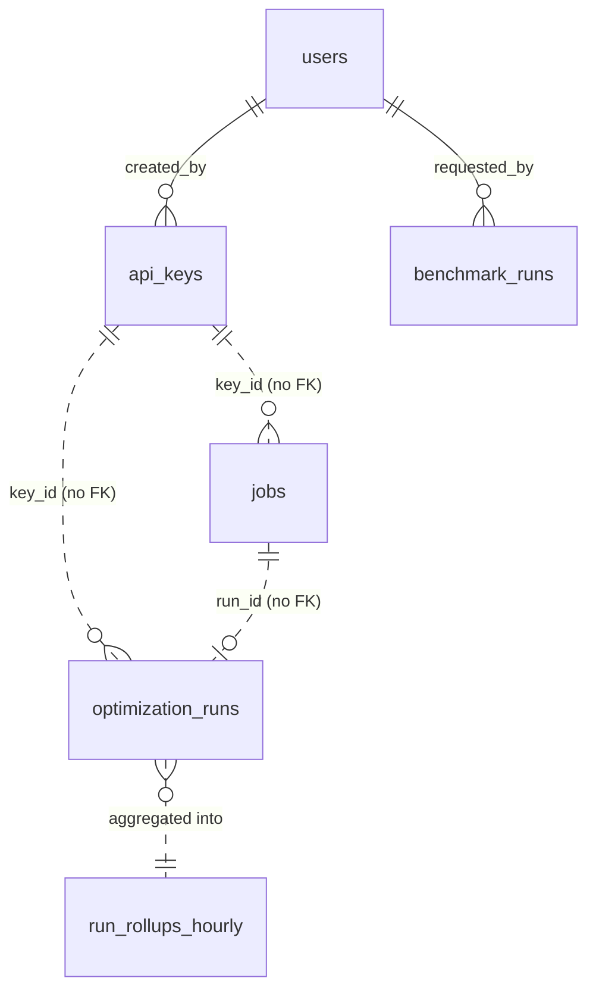

# Data model

PostgreSQL 16. The schema is owned by Alembic
(`apps/api/src/contextforge/migrations/versions/0001_initial_schema.py`, revision
`160f0a778a3a`); SQLAlchemy models live in each domain's `models.py`. Money columns are
`BIGINT` nano-dollars (`*_nusd`, one billionth of a US dollar), the same convention as
[TokenShield](https://github.com/euron-sde-team/euron-open-tokenshield). All timestamps
are `timestamptz`.

ContextForge stores **statistics, not content**. A run row holds counts, flags, the
per-stage trace and the budget allocation; the messages and documents themselves are never
written to Postgres. Anything large (job inputs and results, benchmark reports, and run
content when `STORE_CONTENT=true`) goes to object storage, and the row keeps only the
object key (see [Large payloads](#large-payloads-live-in-object-storage)).



The dotted relations are deliberate: `optimization_runs` and `jobs` carry `key_id` without
a foreign key, so history survives when a key is removed and the append-only run table
never has to be touched by a cascade. `key_name` is copied onto each run for the same
reason.

## Configuration

| Table | Purpose | Columns |
| --- | --- | --- |
| `users` | Dashboard accounts | `id` UUID, `email` (unique), `name`, `password_hash` (argon2), `role` owner/admin/viewer, `disabled`, `last_login_at`, `failed_logins`, `locked_until`, `session_version` (bumped on password change, role change or disable, which ends every existing session), `created_at` |
| `api_keys` | Service keys applications present on `/v1` | `id` UUID, `name`, `prefix` (unique, 12 hex characters, the lookup key), `secret_hash` (peppered HMAC-SHA256 hex), `rpm_limit` (null means `DEFAULT_RPM_LIMIT`), `default_profile`, `default_upstream` (applied to requests made with the key, overridable per request), `expires_at`, `revoked_at`, `last_used_at` (written at most once a minute), `created_by` FK `users.id`, `created_at` |
| `workload_profiles` | Custom workload profiles and overrides of the built-in ones (`coding`, `research`, `support`, `agent`, `rag`, `chat`) | `id` UUID, `name` (unique), `description`, `weights` JSONB (budget share per category), `relevance`, `recency`, `importance` (ranking blend), `updated_at`, `created_at`. Built-in profiles live in code (`engine/profiles.py`); a row with the same name overrides one |
| `upstreams` | OpenAI-compatible endpoints the proxy forwards to | `id` UUID, `name` (unique), `kind` openai/tokenshield/smartrouter, `base_url`, `sealed_key` BYTEA (KMS or AES-GCM ciphertext bound to this row's id, never returned), `key_hint` (`...` plus the last four characters), `max_input_tokens` (default budget for proxied calls), `strategy` (default `balanced`), `enabled`, `created_at` |

## Accounting (append-only)

| Table | Purpose | Columns |
| --- | --- | --- |
| `optimization_runs` | One row per optimization, from any source | `id` BIGSERIAL, `created_at`, `request_id`, `source` (`api`, `proxy`, `playground`, `job`), `key_id`, `key_name`, `model`, `tokenizer` (for example `o200k_base` or `estimate:o200k_base*1.15`), `exact`, `workload`, `profile`, `strategy`, `tokens_before`, `tokens_after` (both recounted with the target tokenizer), `budget`, `budget_met`, `messages_in`, `messages_out`, `documents_in`, `documents_out`, `facts_total`, `facts_retained`, `citations_preserved`, `warnings` JSONB (warning codes), `latency_ms`, `cache_hit`, `cost_avoided_nusd` (estimate from the list price table, null when the model has no price), `upstream`, `upstream_model`, `upstream_status`, `upstream_cost_nusd` (proxy runs only), `summary_tokens`, `allocation` JSONB (budget per category), `trace` JSONB (per-stage timings and notes), `content_key` (object key, only with `STORE_CONTENT=true`) |
| `audit_log` | Every dashboard mutation and every sign-in | `id` BIGSERIAL, `at`, `actor_id`, `actor_email`, `action` (for example `api_key.created`, `upstream.updated`, `auth.login`), `target_type`, `target_id`, `details` JSONB, `ip` |

Both tables are append-only. The migration creates one function and two triggers:

```sql
CREATE FUNCTION contextforge_refuse_change() RETURNS trigger ...
  RAISE EXCEPTION '% is append-only', TG_TABLE_NAME USING ERRCODE = 'check_violation';

CREATE TRIGGER optimization_runs_append_only BEFORE UPDATE OR DELETE ON optimization_runs
  FOR EACH ROW EXECUTE FUNCTION contextforge_refuse_change();
CREATE TRIGGER audit_log_append_only BEFORE UPDATE OR DELETE ON audit_log
  FOR EACH ROW EXECUTE FUNCTION contextforge_refuse_change();
```

An `UPDATE` or `DELETE` on either table fails with SQLSTATE `23514`. This is why a proxied
call is recorded only after the upstream has responded (status line and headers): the
run row is written once, complete with `upstream_status` and `upstream_cost_nusd`, instead
of being inserted and patched later.

Audit rows are added to the same session as the change they describe and committed with
it (`audit/service.py`), so a configuration change without an audit row cannot be
committed.

## Derived and operational

| Table | Purpose | Columns |
| --- | --- | --- |
| `run_rollups_hourly` | Pre-aggregated run counters for the dashboard | primary key (`hour`, `source`, `workload`, `model`); `runs`, `tokens_before`, `tokens_after`, `budget_missed`, `facts_total`, `facts_retained`, `latency_ms_sum`, `cost_avoided_nusd`, `cache_hits` |
| `jobs` | Background optimizations for inputs too large to hold a request open for | `id` UUID, `status` queued/running/succeeded/failed, `key_id` (the owning service key), `model`, `payload_key`, `payload_bytes`, `result_key`, `run_id`, `error` JSONB, `attempts`, `lease_until`, `updated_at`, `finished_at`, `created_at` |
| `benchmark_runs` | Benchmark executions started from the dashboard | `id` UUID, `status`, `requested_by` FK `users.id`, `dataset_version`, `cases`, `runs_per_case`, `summary` JSONB (per strategy), `results` JSONB (per case), `report_key` (markdown report in object storage), `error`, `started_at` (set when a worker claims it; staleness is measured from it), `finished_at`, `created_at`. At most one row is queued or running (`ux_benchmark_runs_active`) |
| `revoked_sessions` | Signed-out dashboard sessions, refused until they would have expired | `jti` (primary key, the token id), `expires_at` (indexed; expired rows are pruned on later sign-outs). In Postgres, not the cache, so eviction can never revive a session |

### Hourly rollups in the same transaction

`runs/service.py` `record()` is the only writer of both tables. In one session it:

1. inserts the `optimization_runs` row and flushes it,
2. truncates the run's `created_at` to the hour and issues
   `INSERT ... ON CONFLICT (hour, source, workload, model) DO UPDATE SET col = col + excluded.col`
   for every counter (`runs` +1, token sums, `budget_missed` +1 when the budget was not met,
   fact counts, `latency_ms_sum`, `cost_avoided_nusd`, `cache_hits` +1 on a result cache
   hit),
3. commits once.

The run and its rollup therefore commit or fail together, so the dashboard's aggregates can
never disagree with the raw table, and concurrent writers are safe because the upsert
increments under Postgres's row lock instead of reading and rewriting a total. The
analytics overview (`GET /api/v1/analytics/overview`) reads only rollup rows for the
requested window and the window before it (for the comparison figures), never the raw run
table, so its cost depends on the number of hours, not the number of runs.

Recording is best effort from the caller's point of view: if Postgres is unavailable, the
caller still receives its optimized context, the failure is logged and counted as
`contextforge_dependency_errors_total{dependency="postgres",op="record_run"}`, and
`run_id` is null in the response.

### Jobs

`POST /v1/context/jobs` writes the request to object storage first, then inserts a `jobs`
row holding only the key. Workers claim the oldest eligible job with
`SELECT ... FOR UPDATE SKIP LOCKED` (status `queued`, or `running` with an expired
`lease_until`), set a lease of `JOB_LEASE_S` (300 s by default) and increment `attempts`.
A crashed worker's job is therefore picked up again when its lease runs out. Deterministic
refusals (unsupported tokenizer, strict budget) fail immediately; other errors requeue the
job until it has been attempted three times.

## Large payloads live in object storage

| Object | Key pattern | Written by | Row reference |
| --- | --- | --- | --- |
| Job input | `jobs/<job id>/payload.json` | `jobs/service.py` create | `jobs.payload_key`, `jobs.payload_bytes` |
| Job result | `jobs/<job id>/result.json` | `jobs/service.py` process | `jobs.result_key` |
| Benchmark report | `benchmarks/<run id>/report.md` | `benchmark_runs/service.py` | `benchmark_runs.report_key` |
| Run content (opt in) | `runs/YYYY/MM/DD/<uuid>.json` | `context/service.py` record, only with `STORE_CONTENT=true` | `optimization_runs.content_key` |

The backend is chosen by `STORAGE`: `local` writes under `LOCAL_STORAGE_DIR` (keys that
would escape the root are refused), `s3` writes to `PAYLOADS_BUCKET` with
`ServerSideEncryption=aws:kms`. On AWS and Floci the `storage` Terraform module creates
one private bucket with public access blocked, KMS encryption and a lifecycle rule that
expires every object after `expiration_days` (30 by default). A row can therefore outlive
its object: an old job or benchmark keeps its statistics, but its result or report is no
longer downloadable.

Keeping these blobs out of the rows keeps Postgres rows small (a run row holds counters,
the allocation and the trace) and keeps multi-megabyte JSON off the hot query paths.

## Indexes

| Index | Table | Serves |
| --- | --- | --- |
| `ix_optimization_runs_created_at` | `optimization_runs (created_at)` | Time-ordered scans and retention queries |
| `ix_optimization_runs_key_id` | `optimization_runs (key_id)` | Runs of one key |
| `ix_runs_source_id` | `optimization_runs (source, id DESC)` | Runs page filtered by source, newest first |
| `ix_runs_workload_id` | `optimization_runs (workload, id DESC)` | Runs page filtered by workload |
| `ix_runs_budget_missed` | `optimization_runs (id DESC) WHERE NOT budget_met` | "Budget missed" filter (partial) |
| primary key | `run_rollups_hourly (hour, source, workload, model)` | Upsert target and analytics window scans |
| `ix_jobs_key_id` | `jobs (key_id)` | Key-scoped job lookups |
| `ix_jobs_claim` | `jobs (created_at) WHERE status IN ('queued', 'running')` | Worker claim (partial, stays small) |
| `ix_benchmark_runs_created_at` | `benchmark_runs (created_at DESC)` | Benchmarks page |
| `ux_benchmark_runs_active` | unique `benchmark_runs ((true)) WHERE status IN ('queued', 'running')` | At most one active benchmark, enforced by the database |
| `ix_jobs_created_at` | `jobs (created_at DESC)` | Jobs page, every status, newest first |
| `ix_revoked_sessions_expires_at` | `revoked_sessions (expires_at)` | Pruning expired sign-outs |
| `ix_audit_log_at` | `audit_log (at)` | Audit log by time |
| unique constraints | `users.email`, `api_keys.prefix`, `workload_profiles.name`, `upstreams.name` | Lookups by natural key |

The runs list and the audit log paginate by primary key (keyset: `WHERE id < :cursor ORDER
BY id DESC LIMIT n+1`), so a page costs the same at any depth.
