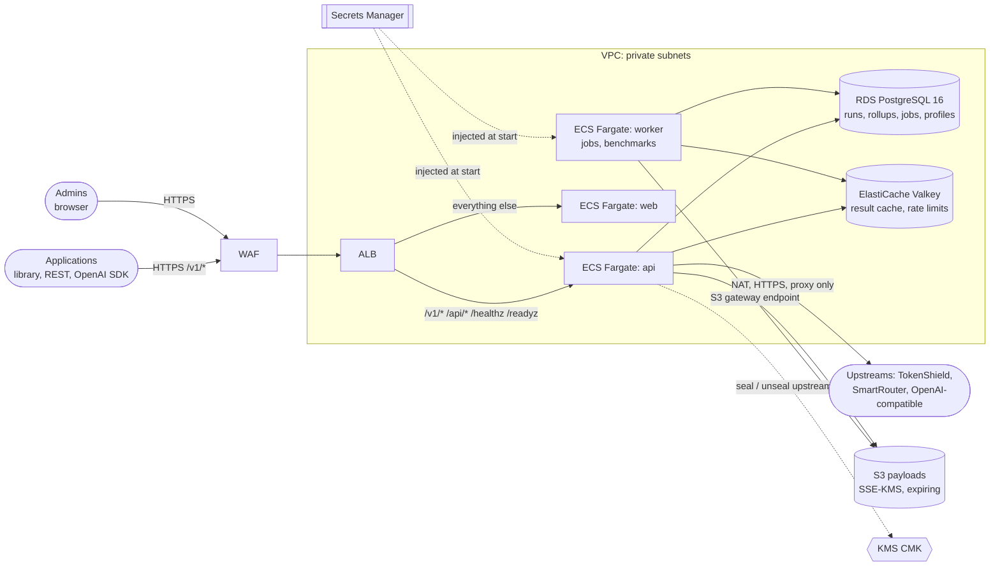

# Infrastructure

Everything needed to run Euron Open ContextForge, from a laptop to a multi-AZ AWS
deployment, as code.

```
infra/
├── docker/        Multi-stage, non-root images: api (context API, proxy, admin API, worker, CLI, mock LLM), web
└── terraform/
    ├── modules/   network · kms · storage · secrets · database · cache · ecr ·
    │              service · observability
    └── envs/
        ├── local-floci/   storage + kms + secrets on the Floci emulator (applied by `make up`)
        ├── aws-dev/       full stack, cost-lean (2 AZs, single NAT, single-AZ DB, one cache node)
        └── aws-prod/      full stack, resilient (3 AZs, NAT per AZ, Multi-AZ DB, cache failover)
```

## One codebase, two clouds

The modules are the same in every environment. `local-floci` points the AWS
provider at the emulator (`http://floci:4566` inside compose) and turns off
only what an HTTP-only emulator cannot do (the TLS-only bucket policy). `make up`
applies it automatically before migrate, api and worker start, and the API then
seals upstream keys with KMS and writes job payloads to S3 exactly as it does on AWS.
The application switches between the two through environment variables only
(`AWS_ENDPOINT_URL`, `S3_FORCE_PATH_STYLE`, `S3_PUBLIC_ENDPOINT`); there are no
emulator branches in the code.

| Resource | Local (Docker) | AWS (module) |
|---|---|---|
| PostgreSQL 16 | `postgres:16.10-alpine` container | RDS PostgreSQL (`database`) |
| Result cache, rate limits, config version (optional) | `redis:7.4.6-alpine` container (`allkeys-lru`) | ElastiCache Valkey, TLS + AUTH (`cache`) |
| Job payloads, benchmark reports | S3 on Floci | S3 (`storage`) |
| Upstream-key sealing, encryption at rest | KMS on Floci | KMS (`kms`) |
| Signing secrets, connection URLs | Secrets Manager on Floci | Secrets Manager (`secrets`) |
| api, worker, web | Compose services from the same images | ECR (`ecr`) + ECS Fargate behind one ALB (`service`) |
| Logs, metrics, alarms | stdout + `/metrics` | CloudWatch (`observability`) |
| Upstream LLM (proxy only) | `mock-llm` (OpenAI-compatible, simulated TokenShield and SmartRouter) | your upstreams |

## AWS topology (aws-dev / aws-prod)



## Order of operations (first deploy)

1. Request an ACM certificate for your host name in the target region.
2. `cp envs/aws-dev/terraform.tfvars.example envs/aws-dev/terraform.tfvars` and fill it in
   (optionally `backend.tf.example` to `backend.tf` for S3 state).
3. `terraform -chdir=infra/terraform/envs/aws-dev init`
4. `terraform -chdir=infra/terraform/envs/aws-dev apply -target=module.ecr`
5. Build both images for `linux/arm64` and push them with the `image_tag` from your tfvars:
   `docker buildx build --platform linux/arm64 -f infra/docker/api.Dockerfile -t <api repo>:<tag> --push apps/api`
   (and the same for `web.Dockerfile` with `apps/web`).
6. `terraform -chdir=infra/terraform/envs/aws-dev apply`
7. Run the migration task with the `run_task` output (`aws ecs run-task ... --launch-type FARGATE`),
   then `create-owner` the same way with a command override
   (`["create-owner", "--email", "you@example.com"]` and `CONTEXTFORGE_OWNER_PASSWORD` in the override environment).
8. Point DNS at `load_balancer_dns_name` if the zone is not in Route53, and sign in at the `url` output.

The full runbook is in [docs/guides/deploy-aws.md](../docs/guides/deploy-aws.md).
This repository itself only ever validates `aws-dev` and `aws-prod`; nothing is
applied to a real account by the project's own tooling.

## Security posture at a glance

| Control | Where |
|---|---|
| No static AWS credentials anywhere (task roles and the default chain only) | all modules |
| Least-privilege IAM per app: payloads bucket objects, KMS only with the `contextforge:record` encryption context or via S3; web has none | service |
| Private subnets for every runtime; no public IPs; ingress only from the ALB, none for the worker | network, service |
| TLS everywhere: ALB TLS 1.3/1.2 policy, `rds.force_ssl`, ElastiCache `transit_encryption_mode = required`, TLS-only bucket policy | service, database, cache, storage |
| Encryption at rest with a rotating CMK (RDS, ElastiCache, S3, ECR, secrets, logs) | kms + consumers |
| Generated secrets (signing keys, DB password, cache AUTH token) injected by ECS, never in task definitions | secrets, database, cache |
| Cache data is recomputable (`allkeys-lru`): a full cache lowers the hit rate, never correctness; a memory alarm warns first | cache, observability |
| WAF managed rules and a per-IP flood guard; prompt-shaped bodies only counted, not blocked; credentials redacted from WAF logs | service |
| `/metrics` reachable through the ALB only from listed CIDRs | service |
| Read-only root filesystems, non-root containers, init process for graceful drain | docker, service |
| Static analysis: `terraform validate`, tflint, checkov (inline, reasoned skips only) | `make tf-validate tf-lint tf-security` |
